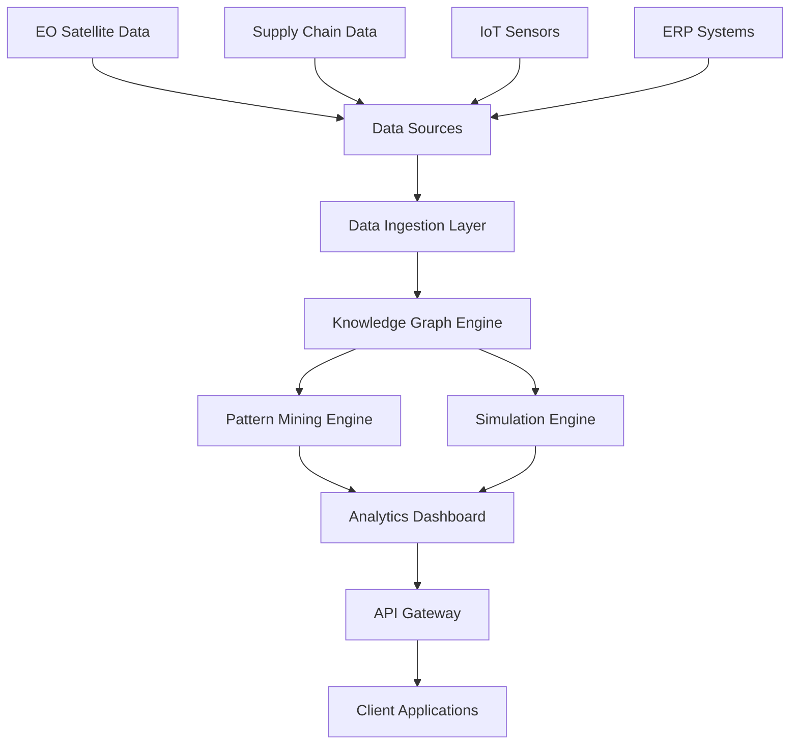

# VeriEarth: Comprehensive Supply Chain Emissions Optimization Platform

## 📋 Table of Contents
1. [Project Overview](#project-overview)
2. [Current State Analysis](#current-state-analysis)
3. [Target Architecture](#target-architecture)
4. [Module Specifications](#module-specifications)
5. [Technology Stack](#technology-stack)
6. [Implementation Roadmap](#implementation-roadmap)
7. [User Scenarios](#user-scenarios)
8. [Data Flow Architecture](#data-flow-architecture)
9. [API Specifications](#api-specifications)
10. [Deployment Strategy](#deployment-strategy)

---

## 🎯 Project Overview

### Vision
VeriEarth is a comprehensive SaaS platform that enables industries and corporations to track, analyze, and optimize their carbon emissions across entire supply chains using advanced pattern mining, Earth Observation data, and prescriptive analytics.

### Mission
Transform supply chain sustainability by providing data-driven insights that identify the most impactful decarbonization opportunities through sequential pattern analysis and real-time environmental monitoring.

### Key Value Propositions
- **Holistic View**: Complete supply chain emissions visibility
- **Pattern-Based Insights**: Identify "frequent offender" patterns vs. rare high-impact events
- **Prescriptive Analytics**: What-if simulation for optimization strategies
- **Real-Time Monitoring**: EO satellite data integration for dynamic environmental context
- **Actionable Intelligence**: Prioritized recommendations for maximum impact

---

## 📊 Current State Analysis

### ✅ What's Implemented (15% of Target)

#### 1. **Authentication & User Management** (100% Complete)
- **Current State**: Full JWT-based authentication with Google OAuth
- **Modules**: `auth/`, `db/models.py` (User model)
- **Status**: Production-ready

#### 2. **Earth Observation Integration** (100% Complete)
- **Current State**: Google Earth Engine integration with Sentinel-5P data
- **Modules**: `aqi/gee_service.py`
- **Capabilities**: 
  - 7 pollutant types (NO2, CO, HCHO, CH4, SO2, AOD, O3)
  - Geospatial polygon validation
  - Temporal aggregation (day/week/month/year)
- **Status**: Production-ready

#### 3. **Basic Reporting** (60% Complete)
- **Current State**: PDF report generation with AQI calculations
- **Modules**: `aqi/report_agent.py`
- **Capabilities**: CPCB-compliant AQI calculations, PDF generation
- **Status**: Functional but needs enhancement

#### 4. **API Infrastructure** (80% Complete)
- **Current State**: FastAPI-based REST API
- **Modules**: `routes/`, `main.py`
- **Status**: Functional with some architectural inconsistencies

### ❌ What's Missing (85% of Target)

#### 1. **Supply Chain Knowledge Graph** (0% Complete)
- No supply chain entity modeling
- No relationship mapping
- No shipment tracking

#### 2. **Sequential Pattern Mining** (0% Complete)
- No event sequence analysis
- No pattern discovery algorithms
- No "frequent offender" identification

#### 3. **Prescriptive Simulation Engine** (0% Complete)
- No what-if scenario testing
- No optimization algorithms
- No multi-objective analysis

#### 4. **Supply Chain Data Models** (0% Complete)
- No facility management
- No route optimization
- No shipment tracking

---

## 🏗️ Target Architecture

### High-Level System Architecture



### Core Components

1. **Data Ingestion & Fusion Layer**
2. **Supply Network Knowledge Graph**
3. **Sequential Pattern Mining Engine**
4. **Prescriptive Simulation Engine**
5. **Analytics & Visualization Dashboard**
6. **API Gateway & Integration Layer**

---

## 🔧 Module Specifications

### 1. Data Ingestion & Fusion Module

#### **Objective**
Ingest, normalize, and fuse heterogeneous data sources including supply chain data, EO satellite data, IoT sensors, and enterprise systems.

#### **Current State**: 30% Complete
- ✅ EO data integration
- ✅ Basic data validation
- ❌ Supply chain data ingestion
- ❌ IoT sensor integration
- ❌ ERP system connectors

#### **Implementation Plan**

**Phase 1: Supply Chain Data Models**
```python
# New models to implement
class Facility(Base):
    __tablename__ = 'facilities'
    id = Column(String, primary_key=True)
    name = Column(String, nullable=False)
    facility_type = Column(Enum(FacilityType))  # warehouse, port, factory, distribution_center
    location = Column(Geometry('POINT'))
    address = Column(Text)
    capacity = Column(Float)
    emission_factors = Column(JSON)
    is_active = Column(Boolean, default=True)
    created_at = Column(DateTime, default=func.now())
    updated_at = Column(DateTime, onupdate=func.now())

class Route(Base):
    __tablename__ = 'routes'
    id = Column(String, primary_key=True)
    origin_facility_id = Column(String, ForeignKey('facilities.id'))
    destination_facility_id = Column(String, ForeignKey('facilities.id'))
    transport_mode = Column(Enum(TransportMode))  # road, rail, air, sea, pipeline
    distance_km = Column(Float)
    duration_hours = Column(Float)
    emission_factor_kg_co2_per_ton_km = Column(Float)
    cost_per_ton = Column(Float)
    is_active = Column(Boolean, default=True)

class Shipment(Base):
    __tablename__ = 'shipments'
    id = Column(String, primary_key=True)
    route_id = Column(String, ForeignKey('routes.id'))
    product_id = Column(String, ForeignKey('products.id'))
    weight_kg = Column(Float)
    volume_m3 = Column(Float)
    shipment_date = Column(DateTime)
    delivery_date = Column(DateTime)
    actual_emissions_kg_co2 = Column(Float)
    cost = Column(Float)
    status = Column(Enum(ShipmentStatus))
```

**Phase 2: Data Connectors**
```python
# ERP Integration
class ERPConnector:
    def sync_facilities(self, erp_system: str):
        # Connect to SAP, Oracle, etc.
        pass
    
    def sync_shipments(self, date_range: tuple):
        # Pull shipment data
        pass

# IoT Sensor Integration
class SensorConnector:
    def ingest_emission_data(self, sensor_id: str):
        # Real-time sensor data
        pass
```

### 2. Supply Network Knowledge Graph

#### **Objective**
Create a comprehensive graph database that models supply chain entities, relationships, and their environmental attributes for advanced analytics.

#### **Current State**: 0% Complete
- ❌ No graph database
- ❌ No entity relationships
- ❌ No supply chain modeling

#### **Implementation Plan**

**Technology Choice**: Neo4j or Amazon Neptune
**Graph Schema**:
```cypher
// Node Types
(:Facility {id, name, type, location, emission_factors})
(:Route {id, mode, distance, emission_factor})
(:Product {id, name, category, weight_factor})
(:Supplier {id, name, location, sustainability_score})
(:Shipment {id, weight, date, emissions})

// Relationships
(:Facility)-[:CONNECTED_TO {distance, mode}]->(:Facility)
(:Route)-[:USES]->(:TransportMode)
(:Shipment)-[:FOLLOWS]->(:Route)
(:Shipment)-[:CARRIES]->(:Product)
(:Facility)-[:SUPPLIES]->(:Product)
```

**Implementation Steps**:
1. Set up Neo4j/Neptune instance
2. Create graph schema
3. Build data ingestion pipeline
4. Implement graph queries for analytics

### 3. Sequential Pattern Mining Engine

#### **Objective**
Analyze shipment and event logs to identify recurring patterns that contribute significantly to emissions, enabling targeted optimization.

#### **Current State**: 0% Complete
- ❌ No pattern mining algorithms
- ❌ No sequence analysis
- ❌ No pattern classification

#### **Implementation Plan**

**Technology Choice**: Python with PrefixSpan, SPADE algorithms
```python
# Pattern Mining Implementation
from prefixspan import PrefixSpan
from collections import defaultdict

class PatternMiningEngine:
    def __init__(self, min_support=0.1):
        self.min_support = min_support
        self.patterns = []
    
    def extract_sequences(self, shipments):
        """Convert shipments to event sequences"""
        sequences = []
        for shipment in shipments:
            sequence = self.build_sequence(shipment)
            sequences.append(sequence)
        return sequences
    
    def mine_patterns(self, sequences):
        """Apply PrefixSpan algorithm"""
        ps = PrefixSpan(sequences)
        patterns = ps.mine(min_support=self.min_support)
        return self.classify_patterns(patterns)
    
    def classify_patterns(self, patterns):
        """Classify patterns as frequent offenders or rare high-impact"""
        classified = {
            'frequent_offenders': [],
            'rare_high_impact': [],
            'optimization_candidates': []
        }
        
        for pattern in patterns:
            if pattern['frequency'] > 100 and pattern['avg_emissions'] > 50:
                classified['frequent_offenders'].append(pattern)
            elif pattern['frequency'] < 10 and pattern['avg_emissions'] > 500:
                classified['rare_high_impact'].append(pattern)
            else:
                classified['optimization_candidates'].append(pattern)
        
        return classified
```

### 4. Prescriptive Simulation Engine

#### **Objective**
Enable what-if scenario testing for supply chain optimization, balancing environmental, economic, and operational objectives.

#### **Current State**: 0% Complete
- ❌ No simulation capabilities
- ❌ No optimization algorithms
- ❌ No scenario testing

#### **Implementation Plan**

**Technology Choice**: Python with PuLP (optimization), SimPy (simulation)
```python
import pulp
from simpy import Environment

class SimulationEngine:
    def __init__(self, knowledge_graph):
        self.kg = knowledge_graph
        self.scenarios = []
    
    def simulate_mode_shift(self, route_id, new_mode):
        """Simulate changing transport mode for a route"""
        route = self.kg.get_route(route_id)
        new_emissions = self.calculate_emissions(route, new_mode)
        new_cost = self.calculate_cost(route, new_mode)
        
        return {
            'emissions_reduction': route.emission_factor - new_emissions,
            'cost_impact': new_cost - route.cost_per_ton,
            'feasibility_score': self.assess_feasibility(route, new_mode)
        }
    
    def simulate_supplier_switch(self, facility_id, new_supplier):
        """Simulate changing supplier for a facility"""
        # Multi-objective optimization
        problem = pulp.LpProblem("SupplierOptimization", pulp.LpMinimize)
        
        # Variables
        x = pulp.LpVariable.dicts("supplier", range(len(suppliers)), cat='Binary')
        
        # Objective: Minimize emissions + cost
        problem += pulp.lpSum([emissions[i] * x[i] for i in range(len(suppliers))])
        
        # Constraints
        problem += pulp.lpSum([x[i] for i in range(len(suppliers))]) == 1
        
        return problem.solve()
    
    def multi_objective_optimization(self, objectives):
        """Balance emissions, cost, and service level"""
        # Implement NSGA-II or similar algorithm
        pass
```

### 5. Analytics & Visualization Dashboard

#### **Objective**
Provide interactive dashboards for visualizing emissions patterns, simulation results, and optimization recommendations.

#### **Current State**: 20% Complete
- ✅ Basic PDF reports
- ❌ Interactive dashboards
- ❌ Real-time visualizations
- ❌ Pattern visualization

#### **Implementation Plan**

**Technology Choice**: React.js + D3.js + WebSocket
```typescript
// Dashboard Components
interface DashboardProps {
  patterns: PatternData[];
  simulations: SimulationResult[];
  emissions: EmissionData[];
}

const EmissionsDashboard: React.FC<DashboardProps> = ({ patterns, simulations, emissions }) => {
  return (
    <div className="dashboard">
      <PatternVisualization patterns={patterns} />
      <SimulationResults simulations={simulations} />
      <EmissionsHeatmap data={emissions} />
      <OptimizationRecommendations />
    </div>
  );
};

// Real-time updates
const useRealTimeData = () => {
  const [data, setData] = useState(null);
  
  useEffect(() => {
    const ws = new WebSocket('ws://localhost:8000/ws');
    ws.onmessage = (event) => {
      setData(JSON.parse(event.data));
    };
  }, []);
  
  return data;
};
```

### 6. API Gateway & Integration Layer

#### **Objective**
Provide comprehensive APIs for enterprise integration and third-party access.

#### **Current State**: 60% Complete
- ✅ Basic REST API
- ❌ GraphQL support
- ❌ WebSocket for real-time
- ❌ Enterprise connectors

#### **Implementation Plan**

**Enhanced API Structure**:
```python
# GraphQL Schema
type Query {
  facilities: [Facility]
  routes: [Route]
  patterns: [Pattern]
  simulations: [Simulation]
}

type Mutation {
  createSimulation(input: SimulationInput): Simulation
  updateRoute(id: ID!, input: RouteInput): Route
}

type Subscription {
  realTimeEmissions: EmissionData
  patternUpdates: PatternData
}
```

---

## 🛠️ Technology Stack

### Backend Technologies
- **Framework**: FastAPI (Python 3.12+)
- **Database**: PostgreSQL + Neo4j/Amazon Neptune
- **ORM**: SQLAlchemy + Neo4j Python Driver
- **Authentication**: JWT + OAuth2
- **Task Queue**: Celery + Redis
- **API**: REST + GraphQL + WebSocket

### Data Processing
- **EO Data**: Google Earth Engine API
- **Pattern Mining**: PrefixSpan, SPADE algorithms
- **Optimization**: PuLP, SciPy
- **Simulation**: SimPy
- **ML/AI**: scikit-learn, TensorFlow

### Frontend Technologies
- **Framework**: React.js 18+
- **Visualization**: D3.js, Chart.js, Mapbox GL
- **State Management**: Redux Toolkit
- **UI Components**: Material-UI or Ant Design
- **Real-time**: WebSocket, Server-Sent Events

### Infrastructure
- **Cloud**: AWS/Azure/GCP
- **Containerization**: Docker + Kubernetes
- **CI/CD**: GitHub Actions
- **Monitoring**: Prometheus + Grafana
- **Logging**: ELK Stack

---

## 🗓️ Implementation Roadmap

### Phase 1: Foundation (Months 1-2)
- [ ] Set up enhanced database schema
- [ ] Implement supply chain data models
- [ ] Create basic knowledge graph
- [ ] Build data ingestion pipeline

### Phase 2: Core Analytics (Months 3-4)
- [ ] Implement pattern mining engine
- [ ] Build simulation framework
- [ ] Create optimization algorithms
- [ ] Develop basic dashboard

### Phase 3: Advanced Features (Months 5-6)
- [ ] Real-time monitoring
- [ ] Advanced visualizations
- [ ] Multi-objective optimization
- [ ] Enterprise integrations

### Phase 4: Production (Months 7-8)
- [ ] Performance optimization
- [ ] Security hardening
- [ ] Load testing
- [ ] Production deployment

---

## 👥 User Scenarios

### Scenario 1: Supply Chain Manager at Manufacturing Company

**User**: Sarah Chen, Supply Chain Manager at TechCorp
**Goal**: Reduce Scope 3 emissions by 30% within 12 months

**Workflow**:
1. **Login** to VeriEarth dashboard
2. **Upload** supply chain data (facilities, routes, suppliers)
3. **View** emissions heatmap showing current hotspots
4. **Analyze** pattern mining results identifying "frequent offenders"
5. **Run simulations** for different optimization scenarios:
   - Mode shift from road to rail for high-volume routes
   - Supplier consolidation to reduce transportation
   - Facility relocation for better logistics
6. **Compare** scenarios based on emissions, cost, and service level
7. **Implement** selected optimizations
8. **Monitor** progress through real-time dashboard

**Expected Outcome**: 35% emissions reduction, 15% cost savings

### Scenario 2: Sustainability Officer at Retail Chain

**User**: Michael Rodriguez, Chief Sustainability Officer at RetailMax
**Goal**: Achieve carbon neutrality by 2030

**Workflow**:
1. **Connect** ERP systems to VeriEarth
2. **Set** carbon reduction targets and KPIs
3. **Monitor** real-time emissions across all supply chain tiers
4. **Receive** automated alerts for emission spikes
5. **Analyze** supplier sustainability scores
6. **Generate** compliance reports for stakeholders
7. **Track** progress toward carbon neutrality goals

**Expected Outcome**: Transparent sustainability reporting, stakeholder confidence

### Scenario 3: Logistics Planner at Shipping Company

**User**: David Kim, Logistics Planner at GlobalLogistics
**Goal**: Optimize route planning for minimum emissions

**Workflow**:
1. **Input** shipment requirements and constraints
2. **Analyze** historical patterns and seasonal variations
3. **Simulate** different routing strategies
4. **Optimize** for multi-objective function (emissions, cost, time)
5. **Generate** optimized route recommendations
6. **Monitor** actual vs. predicted performance
7. **Iterate** based on real-world results

**Expected Outcome**: 25% emissions reduction, improved route efficiency

---

## 🔄 Data Flow Architecture

### 1. Data Ingestion Flow
```
External Systems → API Gateway → Data Validation → Knowledge Graph → Pattern Mining
     ↓
EO Satellites → Data Fusion → Environmental Context → Simulation Engine
     ↓
IoT Sensors → Real-time Processing → Alert System → Dashboard
```

### 2. Analytics Flow
```
Knowledge Graph → Pattern Mining → Pattern Classification → Optimization Engine
     ↓
Simulation Results → Multi-objective Analysis → Recommendations → Dashboard
     ↓
User Actions → Scenario Testing → Impact Analysis → Implementation
```

### 3. Real-time Flow
```
Live Data Sources → WebSocket → Real-time Processing → Dashboard Updates
     ↓
Pattern Detection → Alert Generation → Notification System → User Action
```

---

## 📡 API Specifications

### Core Endpoints

#### Supply Chain Management
```http
GET /api/facilities
POST /api/facilities
PUT /api/facilities/{id}
DELETE /api/facilities/{id}

GET /api/routes
POST /api/routes
PUT /api/routes/{id}

GET /api/shipments
POST /api/shipments
```

#### Pattern Analysis
```http
GET /api/patterns
GET /api/patterns/frequent-offenders
GET /api/patterns/rare-high-impact
POST /api/patterns/analyze
```

#### Simulation Engine
```http
POST /api/simulations
GET /api/simulations/{id}
POST /api/simulations/{id}/scenarios
GET /api/simulations/{id}/results
```

#### Real-time Data
```http
WebSocket: /ws/emissions
WebSocket: /ws/patterns
WebSocket: /ws/alerts
```

---

## 🚀 Deployment Strategy

### Development Environment
- **Local Development**: Docker Compose
- **Database**: PostgreSQL + Neo4j
- **Cache**: Redis
- **Monitoring**: Local Prometheus

### Staging Environment
- **Cloud**: AWS/Azure
- **Container**: Kubernetes
- **Database**: Managed services
- **Monitoring**: CloudWatch/Azure Monitor

### Production Environment
- **High Availability**: Multi-region deployment
- **Scalability**: Auto-scaling groups
- **Security**: VPC, WAF, encryption
- **Backup**: Automated backups
- **Disaster Recovery**: Cross-region replication

---

## 📈 Success Metrics

### Technical Metrics
- **API Response Time**: < 200ms
- **System Uptime**: 99.9%
- **Data Processing**: Real-time (< 1 minute)
- **Pattern Mining**: < 5 minutes for 1M records

### Business Metrics
- **User Adoption**: 80% of target users
- **Emissions Reduction**: 25% average
- **Cost Savings**: 15% average
- **Customer Satisfaction**: 4.5/5 rating

---

## 🎯 Next Steps

### Immediate Actions (Week 1-2)
1. **Database Schema Design**: Create comprehensive supply chain models
2. **Technology Stack Setup**: Configure Neo4j, Redis, Celery
3. **API Planning**: Design GraphQL schema and REST endpoints
4. **Team Assembly**: Assign roles and responsibilities

### Short-term Goals (Month 1-2)
1. **Core Data Models**: Implement facility, route, shipment models
2. **Knowledge Graph**: Set up Neo4j with basic schema
3. **Pattern Mining**: Implement PrefixSpan algorithm
4. **Basic Dashboard**: Create React frontend with core features

### Long-term Vision (Month 6+)
1. **Full Platform**: Complete end-to-end functionality
2. **Enterprise Integration**: SAP, Oracle, Salesforce connectors
3. **AI Enhancement**: Machine learning for pattern prediction
4. **Global Scale**: Multi-tenant, multi-region deployment

---

*This document serves as the comprehensive blueprint for transforming VeriEarth from a basic environmental monitoring tool into a full-scale supply chain emissions optimization platform that can compete with enterprise solutions while providing unique value through pattern mining and prescriptive analytics.*
